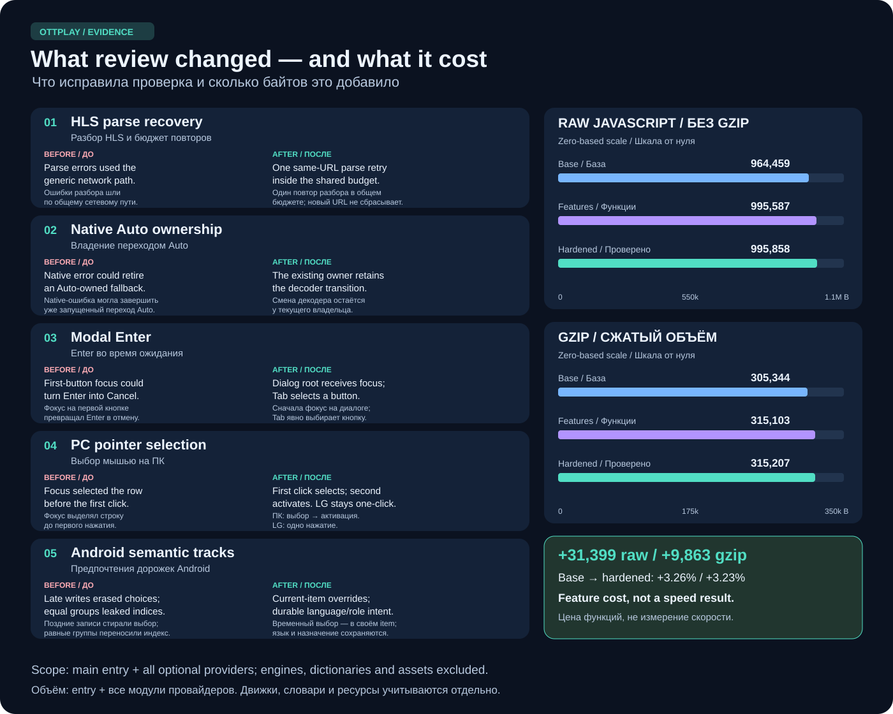

# От списка функций к проверенному поведению

[English](implementation-report.md) · [Контракты функций](roadmap-delivery.ru.md) · [Измерения объёма](roadmap-size.ru.md)

Это отчёт о реализации и исправлениях после проверки, а не объявление релиза.
Измеренный снимок плеера — `652726f8`, отдельно собранного native Android —
`be0d800`. CI, слияние и выпуск остаются самостоятельными этапами. Последующий
коммит документации или тестов не доказывает, что установленное устройство
получило обновление.

## Как проверялась работа

Исходную задачу разделили на 13 применимых функций в классическом плеере,
сервере управления с CLI и независимом Android-приложении. Ответственность
разделили по компонентам, чтобы параллельные изменения можно было проверять и
объединять без перезаписи чужой работы. Интерфейс использует существующие
переводы либо новые строки во всех 88 каталогах; полные инженерные инструкции
подготовлены на русском и английском.

После реализации проводились независимая перекрёстная проверка и воспроизведение
ошибок тестами. Замечание сначала сопоставляли с реальным путём callback,
декодера, хранилища или фокуса. Падения разделяли на ошибки поведения и устаревшие
селекторы тестов. Например, смена роли строки с `button` на `option` требовала
исправления селектора, но не ослабления проверки двух нажатий на ПК.

Чистая production-сборка проверяла итоговый ES5 и полный объём JavaScript,
включая дополнительные модули провайдеров. Целевые браузерные тесты использовали
поставляемый загрузчик, собранный плеер и адаптеры устройств. Для native Android
отдельно выполнялись Gradle-тесты, lint и сборка пакетов. После push заново
проверяются CI и обсуждения PR; локальный успех их не заменяет.

## Что исправила повторная проверка

- **Разбор HLS и повторы:** ошибки разбора сначала относились к общим сетевым.
  Теперь для них разрешено не более одного переподключения к тому же URL,
  входящего в общий бюджет двух повторов временной ошибки. Новый декодер или
  резервный URL бюджет не обновляет. Ошибка авторизации/DRM отменяет и ранее
  запланированный повтор временной ошибки.
- **Native Auto:** обработчик native-ошибки мог завершить запрос, пока Auto
  уже управлял переходом на другой декодер. Теперь этот переход сохраняет
  своего владельца; отмена продолжает блокировать запоздавшие callback.
- **Enter в диалоге:** автоматический фокус на первой кнопке «Отмена» превращал
  Enter во время ожидания Plex в отмену. Теперь сначала фокусируется сам диалог,
  а Tab явно выбирает кнопку. Обычные информационные диалоги и подтверждения
  сохраняют поведение Enter и Escape/Назад.
- **Выбор мышью на ПК:** фокус мыши менял выделение до обработчика click, и
  первое нажатие уже активировало строку. Теперь такой фокус не опережает click.
  ПК по-прежнему сначала выбирает, затем активирует; на LG работает одно
  нажатие. Клавиатурный фокус продолжает синхронизироваться с выделением.
- **Дорожки Android:** выбор дорожки без метаданных мог исчезать от собственного
  подтверждения Auto или изменения субтитров, либо переноситься в другой
  media item с равным `TrackGroup`. Теперь он переживает запоздавшие записи
  только в текущем элементе. Постоянное предпочтение хранит язык, назначение и
  подпись; запись принадлежит ViewModel и не отменяется при закрытии панели.

13 реализованных частей: A/V-образец; возобновляемая настройка Local/Home;
ограниченные повторы; пределы качества; дорожки Android; ограниченные ключи
управления; привязки XMLTV; фильмы/сериалы Xtream; доступность классического UI;
сохраняемые исходы команд; явная передача просмотра; резервные потоки;
восстановление пакетных настроек. Границы каждой описаны в
[руководстве по функциям](roadmap-delivery.ru.md).

## Подтверждения и оставшиеся этапы

На `652726f8` прошли пять целевых браузерных сценариев: указатель LG webOS,
указатель LG NetCast, два нажатия на ПК, клавиатура диалогов и полный цикл
Plex «сбор → получение потока → отмена → повтор». Прошли TypeScript, unit-тест
доступности, lint затронутых файлов, ES5 и проверка лимита сборки. Полный браузерный прогон по этой сборке завершился: **194 сценария прошли,
один пропущен** — native HLS проверяется в WebKit, а этот прогон выполнен в
Chromium. Удалённый CI и согласованное слияние остаются отдельными этапами.

В Android `be0d800` локально прошли **101 тест приложения и 62 теста общего
ядра**, debug/release lint, сборка Debug/Release/Full APK, release bundle и APK
для instrumented-тестов. Сборка тестового APK не означает выполнение тестов
на устройстве. На три подтверждённых замечания в
[Android PR 68](https://github.com/open-ott-play/ottplay-android/pull/68) даны
ответы, обсуждения закрыты; этап CI/релиза на диаграмме намеренно оставлен
незавершённым.

Полный web JavaScript вырос с **964 459 / 305 344** до **995 858 / 315 207**
байт до/после gzip: **+31 399 / +9 863 байта**, около 3,26% / 3,23%.
Кандидат с функциями занимал 995 587 / 315 103; последующие исправления добавили
271 / 104 байта. Основной итоговый entry — 875 197 / 270 425. Источники:
[сравнение с базой](evidence/roadmap-size-20261015.json),
[измерение итогового артефакта](evidence/roadmap-final-size-20261015.json) и
[методика](roadmap-size.ru.md).

Это стоимость в байтах, **не измеренное ускорение**. В суммы не входят
медиадвижки, словари, CSS, изображения и видео. Отдельный A/V-образец добавляет
464 652 байта к поставляемым ресурсам. Время запуска, плавность кадров, память,
экранный диктор, HDMI-звук и поведение провайдера требуют собственных измерений
на устройствах. Этот отчёт не заявляет новую аппаратную проверку или выпуск
бета-версии. Для продвижения остаются
[список аппаратной приёмки](roadmap-delivery.ru.md#проверка-на-устройствах-перед-выпуском)
и [правила релиза](../RELEASING.md).

## Доставка изменений

- [Плеер, документация и i18n — PR 781](https://github.com/open-ott-play/ottplay-foss/pull/781).
- [Сервер управления и CLI — PR 106](https://github.com/open-ott-play/ottplay-control-server/pull/106).
- [Предпочтения дорожек Android — PR 68](https://github.com/open-ott-play/ottplay-android/pull/68).

Состояние CI и слияния проверяется по этим PR. Плеер поставляется следующей
волной после согласованной текущей серии исправлений Plex и её бета-релиза.
