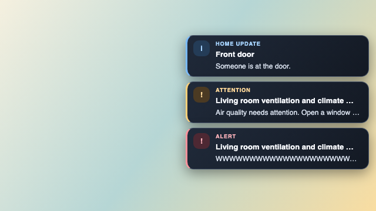
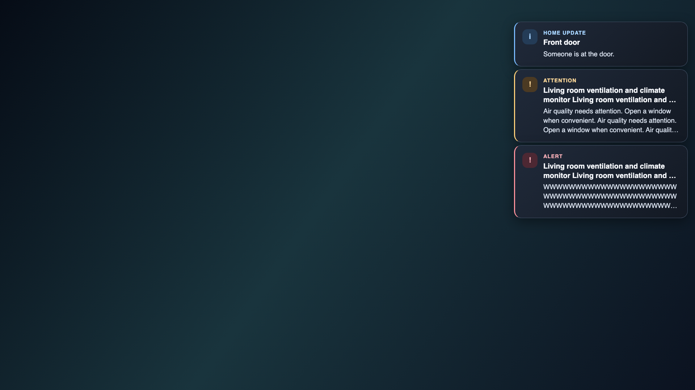
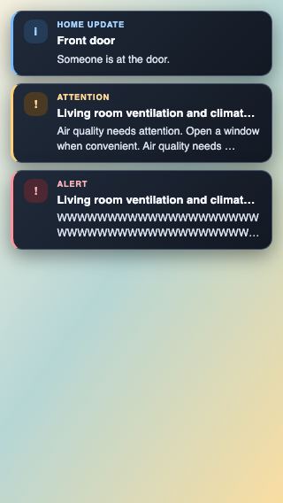

# Remote notification presentation

Home Assistant events appear as temporary cards over an active player. The
controller supplies the title and message; the player adds the English severity
label **Home update**, **Attention**, or **Alert**. Translate controller templates
at their source rather than changing entity names or translating incoming text
inside the player.

The cards size themselves against the viewport, independently of the player
skin's text size. Text ranges from 13 to 20 CSS pixels in current browsers, with
a 14-pixel fallback. A card is at most 24 text units wide and stays within the
window margins. Compact windows reduce padding and the number of visible text
lines. Long titles and messages are clipped to bounded previews so three
simultaneous notifications fit normal small windows. This is a transient preview,
not a complete event history; keep controller messages concise.

An opaque dark background keeps contrast stable over bright or dark video.
Severity has both a text label and a decorative badge. Older WebViews use solid
background, fixed-font, word-wrap and bounded-height fallbacks; layout does not
require backdrop filters, flex gap, JavaScript resize handlers or external fonts.
Reduced-motion settings disable the entrance animation.

Presentation does not change delivery: cards never take focus or pointer input,
never wake a sleeping player, retain the bounded three-card queue and existing
expiry/deduplication rules, and disappear when the player becomes inactive.
All remote text is rendered literally with `textContent`.

## Verification

```sh
npm run build
node tests/test_remote_notifications.cjs
node tests/test_command_server.cjs
npx playwright test tests/browser/remote-notifications.spec.cjs
```

The browser suite checks 640×360 (including installed-app titlebar geometry),
960×540, 320×568, 844×390 and 1920×1080 viewports. It forces the surrounding
player font to 48 pixels to detect inherited-size regressions and tests three
cards, long unbroken strings, literal HTML-like input, reduced motion and
standby clearing. It saves screenshots of the built player over synthetic
bright and dark backgrounds; these are contrast/layout fixtures, not footage
or physical-device certification. Native Tauri/LG/Android acceptance remains
part of release validation.

### Layout examples

These are rendered screenshots of the built player with synthetic backgrounds
and deliberately long test messages. Physical device playback is not simulated.

Compact 640×360 window with installed-app titlebar spacing:



1920×1080 viewport:



320×568 portrait viewport:


