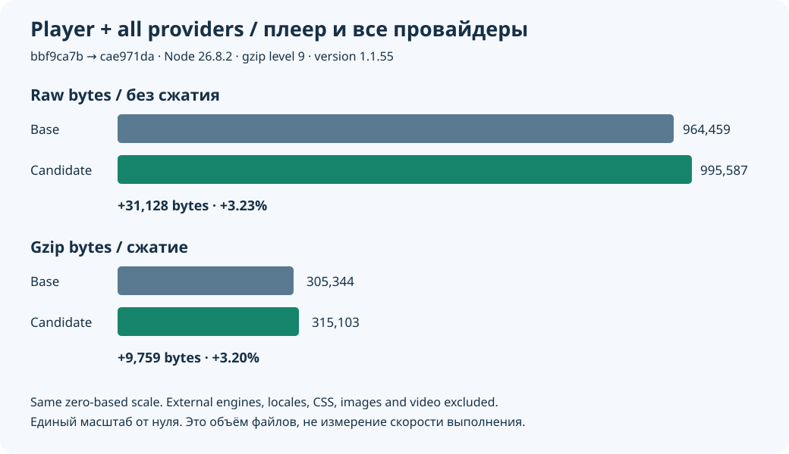

# Measured JavaScript cost

[Русский](roadmap-size.ru.md) · [Feature guide](roadmap-delivery.md) · [Raw evidence](evidence/roadmap-size-20261015.json)

The implementation adds **31,128 raw bytes / 9,759 gzip bytes** to the main entry
plus every optional provider family: about **3.23% / 3.20%**. It is a feature-cost
increase, not a claimed size or execution-speed improvement. Xtream remains lazy;
moving it out of the entry does not remove it from the total.

The measurement compares clean source archives `bbf9ca7b` and `cae971da`, both
version 1.1.55, with Node 26.8.2, TypeScript 5.9.3, Terser 5.51.2 and zlib 1.2.12.
It uses the production ES5 assembler, optimizer, name policy and correct clean
source identity. Gzip level 9 is applied separately to each emitted asset.

- Web entry: 848,092 / 262,392 → 874,926 / 270,321 raw/gzip bytes.
- Web entry + all providers: 964,459 / 305,344 → 995,587 / 315,103.
- Native entry: 848,050 / 262,460 → 874,884 / 270,372.
- Native entry + all providers: 964,417 / 305,412 → 995,545 / 315,154.
- Optional M3U grows 184 raw / 82 gzip bytes; new Xtream is 4,110 / 1,748.
  The other six optional families are byte-identical.

A later rooted A/V asset URL adds one raw byte; build identity and gzip bytes
can change in the final commit. Final `build/reports/classic-bundle.json` and
`npm run check:size` remain the authority for the exact delivered revision.
The reviewed caps retain the previous native/Node/release-suffix allowance:
875,300 raw / 271,600 gzip for the entry; 996,100 / 316,400 for entry + providers.

**Scope:** these totals exclude external media engines, language dictionaries,
CSS, images and video. The new optional A/V clip adds **464,652 bytes to packaged
assets**, fetched for the explicit diagnostic action rather than startup playback.
The 88 localized README files are repository documentation, not player payload.
No startup-time, frame-rate, memory or catalogue-scale performance claim follows
from this byte comparison. Those require separate measurements on target devices.
