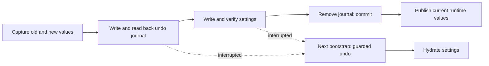

# Recoverable multi-key settings

[Русский](settings-recovery.ru.md) · [Improvements](roadmap-delivery.md)

Supported localStorage batches use `ottplaySettingsJournalV1`, an internal undo
journal excluded from export, cloud payloads and ordinary setting enumeration.
Before mutating settings, the writer records each key's exact old/new string
(or null), reads the journal back, writes and verifies the batch, then removes
the journal as its commit point. Runtime changes publish only while the captured
settings owner remains current. Unrelated keys are not cleared by an import.

Bootstrap recovers before hydrating settings. It restores an old value only
while the stored value still equals this batch's new value, preserving a later
foreign edit. It validates the journal and ownership throughout recovery.
A failed or corrupt journal does not silently permit hydration of a partial
account configuration; preserve/export the raw storage for diagnosis before
manual repair. Journal limits: 16,000 entries and 2 MiB serialized text.

**Guarantee boundary:** one writer, one supported native localStorage backing
store. Browsers provide no atomic compare-and-swap across tabs. Do not run
concurrent imports in multiple windows; this is not a multi-tab transaction or
database. Power-loss durability is limited by the browser/OS storage itself.
Cookie/session/custom device adapters keep guarded best-effort rollback; they
do not gain persistent journaling. There is no distributed transaction with
the remote controller or another player.

The journal temporarily contains old/new setting values, potentially including
provider credentials, in the same origin storage that already holds them.
It is not telemetry and must not be copied into public bug reports. Quota failure
while preparing the journal stops before writes. Do not remove a pending journal
just to hide a failed import; that discards its recovery information.

Run `node tests/test_settings_journal.cjs`, `node tests/test_settings_store.cjs`,
`node tests/test_local_settings_backup.cjs` and
`node tests/test_cloud_settings_session.cjs`. Tests restart from snapshots of
interrupted writes, interrupt recovery itself, preserve foreign values and
exercise quota/corruption/reentrancy failures.
